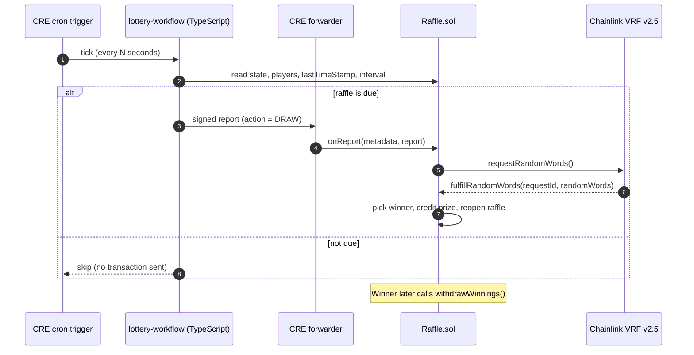
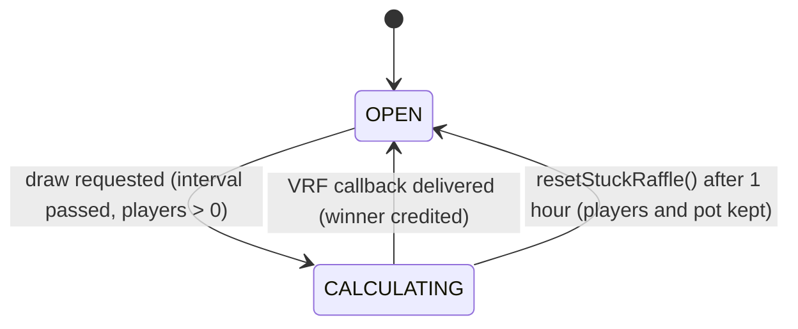

# Smart Contract Lottery

> A provably fair raffle on Ethereum. Winners are picked with **Chainlink VRF v2.5**, and draws are triggered automatically by a **Chainlink Runtime Environment (CRE)** workflow running on a cron schedule.


> **Status: testnet demo, not audited.** Do not use with real funds. See [Security considerations](#security-considerations).

## Table of contents

- [Overview](#overview)
- [How it works](#how-it-works)
- [Repository layout](#repository-layout)
- [Smart contract reference](#smart-contract-reference)
- [Getting started](#getting-started)
- [Deploying to Sepolia](#deploying-to-sepolia)
- [Running the CRE automation](#running-the-cre-automation)
- [Interacting with the raffle](#interacting-with-the-raffle)
- [Sepolia deployment](#sepolia-deployment)
- [Testing](#testing)
- [Gas notes for Sepolia](#gas-notes-for-sepolia)
- [Security considerations](#security-considerations)
- [Roadmap](#roadmap)
- [License](#license)

## Overview

Players enter by paying an entrance fee in ETH. When the draw interval has passed and at least one player has entered, a random winner is selected using verifiable on-chain randomness, and the whole pot is credited to them. Nobody, including the contract owner, can predict or influence the outcome.

| Concern | Solution |
|---|---|
| Randomness | Chainlink VRF v2.5 (subscription model) |
| Automation | Chainlink CRE cron workflow (TypeScript) delivering signed reports to the contract |
| Payouts | Pull payments: winners call `withdrawWinnings()`, so a hostile winner can never block the raffle |
| Liveness | Stale VRF callbacks are ignored, and anyone can reset a raffle stuck for over an hour |
| Tooling | Foundry (build, test, scripts), Makefile shortcuts |

## How it works



The workflow checks readiness off-chain to avoid wasting transactions, and the contract re-checks everything on-chain, so a stale read can never cause a wrong draw.

**Raffle states**



## Repository layout

This repository holds two projects:

```text
smart-contract-lottery/
├── smartcontractlottery/            # Foundry project: contracts, scripts, tests
│   ├── src/
│   │   ├── Raffle.sol               # The raffle (VRF consumer + CRE receiver)
│   │   └── interfaces/IReceiver.sol # CRE report receiver interface
│   ├── script/
│   │   ├── DeployRaffle.s.sol       # Deploy + register VRF consumer
│   │   ├── HelperConfig.s.sol       # Per-network configuration (Sepolia, local Anvil)
│   │   └── Interactions.s.sol       # Create/fund subscription, add consumer
│   ├── test/
│   │   ├── unit/                    # Unit tests (mock VRF coordinator)
│   │   ├── integration/             # Script integration tests
│   │   ├── staging/                 # Tests meant for deployed networks
│   │   └── mocks/LinkToken.sol
│   ├── Makefile
│   └── foundry.toml
└── smartContractLotteryAutomation/  # CRE project
    ├── project.yaml                 # CRE targets and RPC endpoints
    └── lottery-workflow/
        ├── main.ts                  # Cron trigger, read, decide, write
        ├── config.staging.json      # Schedule and raffle target
        ├── config.production.json
        └── workflow.yaml            # Workflow names and config paths per target
```

## Smart contract reference

`Raffle` inherits `VRFConsumerBaseV2Plus` and implements the CRE `IReceiver` interface directly. It does not use `ReceiverTemplate`, because that would bring a second `Ownable` base that clashes with the VRF base's owner implementation.

### Key parameters (Sepolia defaults)

| Parameter | Value |
|---|---|
| Entrance fee | 0.01 ETH |
| Draw interval | 30 seconds |
| VRF request confirmations | 3 |
| VRF callback gas limit | 500,000 |
| Stuck-raffle reset timeout | 1 hour |

### External functions

| Function | Who can call | Description |
|---|---|---|
| `enterRaffle()` | Anyone | Pay at least the entrance fee while the raffle is `OPEN`. The whole payment goes into the pot. |
| `onReport(metadata, report)` | CRE forwarder only | Entry point for automation. `report` is `abi.encode(uint8 action)`: `1` starts a draw, `2` resets a stuck raffle. If the raffle is not ready, it emits `DrawSkipped(reason)` instead of reverting. |
| `pickWinner()` | Anyone, when a draw is due | Permissionless fallback if automation is down. Reverts with a descriptive error when not due. |
| `resetStuckRaffle()` | Anyone, after the timeout | Re-opens a raffle stuck in `CALCULATING`. Players and the pot carry over. |
| `withdrawWinnings()` | Winners | Pull payment of credited prizes. |

### Views

`getEntranceFee`, `getPlayers(index)`, `getNumberOfPlayers`, `getRecentWinner`, `getRaffleState`, `getInterval`, `getLastTimeStamp`, `getWinnings(address)`, `getForwarder`.

### `DrawSkipped` reason codes

| Code | Meaning |
|---|---|
| 1 | Raffle is not `OPEN` |
| 2 | Interval has not passed |
| 3 | No players |
| 4 | Reset not allowed yet |

## Getting started

### Prerequisites

- [Foundry](https://book.getfoundry.sh/getting-started/installation) (tested with 1.5.1 and 1.8.7)
- [Bun](https://bun.sh) 1.2.21 or newer (for the CRE workflow)
- The [CRE CLI](https://docs.chain.link/cre) and a CRE account (`cre login`)
- A funded Sepolia account, an RPC URL and an Etherscan API key (for deployment)

### Clone, build and test

Dependencies are included under `smartcontractlottery/lib`, so no install step is needed.

```bash
git clone https://github.com/IKMC/smart-contract-lottery.git
cd smart-contract-lottery/smartcontractlottery

forge build --sizes
forge test
```

### Environment

Create `smartcontractlottery/.env` (it is git-ignored):

```bash
SEPOLIA_RPC_URL=https://...
ETHERSCAN_API_KEY=...
```

Import your deployer key into an encrypted Foundry keystore instead of keeping it in `.env`. The Makefile and the examples below expect the account name `myaccount`:

```bash
cast wallet import myaccount --interactive
```

## Deploying to Sepolia

1. **Create and fund a VRF v2.5 subscription** at [vrf.chain.link](https://vrf.chain.link) (Sepolia), using the same account you deploy with. The subscription owner must be the account that adds the consumer.
2. **Set the subscription ID** in `getSepoliaEthConfig()` in `script/HelperConfig.s.sol`. A VRF v2.5 subscription ID cannot be created and used within one broadcast script on a live network.
3. **Deploy.** The script deploys `Raffle` and then registers it as a consumer:

   ```bash
   forge script script/DeployRaffle.s.sol:DeployRaffle \
     --rpc-url $SEPOLIA_RPC_URL --account myaccount \
     --broadcast --gas-estimate-multiplier 900 -vvvv
   ```

   The large multiplier is deliberate. See [Gas notes for Sepolia](#gas-notes-for-sepolia).
4. **Confirm** the new address appears as a consumer on your subscription page.
5. **Verify the source** (optional), for example with `forge verify-contract`.

## Running the CRE automation

The workflow lives in `smartContractLotteryAutomation/lottery-workflow`. It reads the raffle's state on each cron tick and, when a draw is due, sends a signed report through the forwarder.

### Configure

Edit `lottery-workflow/config.staging.json`:

```json
{
  "schedule": "*/30 * * * * *",
  "evms": [
    {
      "raffleAddress": "0xYourRaffleAddress",
      "chainSelectorName": "ethereum-testnet-sepolia",
      "gasLimit": "800000"
    }
  ]
}
```

| Field | Description |
|---|---|
| `schedule` | Six-field cron expression, seconds first (`*/30 * * * * *` is every 30 seconds) |
| `evms[0].raffleAddress` | Deployed `Raffle` address. Must be a valid checksummed address. |
| `evms[0].chainSelectorName` | CRE chain name |
| `evms[0].gasLimit` | Gas limit for the report delivery. Keep it generous (see gas notes). |

The `Raffle` only accepts reports from the forwarder set at deployment (`getForwarder()`). The forwarder configured for Sepolia in `HelperConfig.s.sol` must match the one your CRE simulation or deployment uses. You can check it with `cre workflow supported-chains`.

### Simulate

```bash
cd smartContractLotteryAutomation
(cd lottery-workflow && bun install)

# Needs a funded testnet key for chain writes. Use a throwaway key, never your main wallet.
echo 'CRE_ETH_PRIVATE_KEY=<throwaway-testnet-key>' >> .env

cre workflow simulate lottery-workflow --target staging-settings              # dry run
cre workflow simulate lottery-workflow --target staging-settings --broadcast  # real Sepolia transaction
```

Press Enter at the "skip waiting" prompt to fire the cron callback immediately. Enter the raffle first, so there is a player to draw.

The simulator fires the callback **once per run**. Recurring scheduled execution requires deploying the workflow, which currently requires CRE deployment access (`cre account access`).

> A successful transaction does not prove a draw started, because `onReport` skips quietly when the raffle is not ready. Check `getRaffleState()` or look for a `DrawSkipped` event on the transaction.

## Interacting with the raffle

```bash
RAFFLE=0xYourRaffleAddress

# Enter (entrance fee is 0.01 ETH)
cast send $RAFFLE "enterRaffle()" --value 0.01ether --rpc-url $SEPOLIA_RPC_URL --account myaccount

# Inspect state (0 = OPEN, 1 = CALCULATING)
cast call $RAFFLE "getRaffleState()(uint8)" --rpc-url $SEPOLIA_RPC_URL
cast call $RAFFLE "getNumberOfPlayers()(uint256)" --rpc-url $SEPOLIA_RPC_URL
cast call $RAFFLE "getRecentWinner()(address)" --rpc-url $SEPOLIA_RPC_URL

# Winner claims the prize
cast call $RAFFLE "getWinnings(address)(uint256)" <winner> --rpc-url $SEPOLIA_RPC_URL
cast send $RAFFLE "withdrawWinnings()" --rpc-url $SEPOLIA_RPC_URL --account myaccount

# Fallbacks if automation is unavailable
cast send $RAFFLE "pickWinner()" --rpc-url $SEPOLIA_RPC_URL --account myaccount
cast send $RAFFLE "resetStuckRaffle()" --rpc-url $SEPOLIA_RPC_URL --account myaccount
```

## Sepolia deployment

| Item | Address |
|---|---|
| Raffle | [`0xd5ebEe26A4D5D548A50f828f349CB817408bb673`](https://sepolia.etherscan.io/address/0xd5ebEe26A4D5D548A50f828f349CB817408bb673) |
| VRF Coordinator v2.5 | `0x9DdfaCa8183c41ad55329BdeeD9F6A8d53168B1B` |
| LINK token | `0x779877A7B0D9E8603169DdbD7836e478b4624789` |
| CRE forwarder (configured) | `0xF8344CFd5c43616a4366C34E3EEE75af79a74482` |
| VRF key hash (gas lane) | `0x787d74caea10b2b357790d5b5247c2f63d1d91572a9846f780606e4d953677ae` |

## Testing

```bash
cd smartcontractlottery
forge test -vvv
```

| Suite | Tests | Notes |
|---|---|---|
| `test/unit` | 7 | Entering, state transitions, `pickWinner`, full winner flow with the mock VRF coordinator |
| `test/integration` | 1 | Subscription creation through the scripts |
| `test/staging` | 2 | Designed for deployed networks. They exit early on a local chain. |

**Not yet covered by tests:** `onReport` (forwarder checks and action routing), `resetStuckRaffle`, stale-callback handling and the `withdrawWinnings` failure path. See the [Roadmap](#roadmap).

## Gas notes for Sepolia

Sepolia activated Ethereum's Glamsterdam upgrade, which raises the gas cost of creating state (new contract code and new storage slots). Foundry's local simulation still prices transactions under the old rules, so **its gas estimates on Sepolia are too low** and transactions that look fine in simulation can run out of gas on-chain.

What this means in practice:

- Deploy with `--gas-estimate-multiplier 900`. The Raffle deployment used about 14.7M gas on Sepolia, against a local estimate of about 1.7M. Unused gas is refunded, so over-provisioning costs almost nothing.
- Contract size now translates directly into deployment cost. Measured with solc 0.8.30, the Raffle's runtime bytecode is **9,125 bytes with the optimizer off and 4,852 bytes with it on (200 runs)**.
- Keep the CRE workflow's `gasLimit` generous. A draw request used about 275k gas in testing.
- Use `cast send` or `forge create` for one-off transactions: they take their gas estimate from the node rather than from the local simulator.

## Security considerations

**Design choices**

- `onReport` accepts calls only from the configured forwarder. The forwarder address is immutable.
- Prizes are pull payments, so a winner that rejects ETH cannot lock the raffle. The pot is tracked separately from the contract balance, so unclaimed prizes are never counted in a later round.
- VRF callbacks are matched against the latest request ID. A late or duplicate callback is ignored rather than reverting.
- The permissionless `pickWinner()` and `resetStuckRaffle()` functions check every precondition on-chain.

**Known limitations**

- The contract has not been audited and the new code paths are not yet fully tested.
- The players array is unbounded. With very many players, clearing it in the VRF callback could exceed the callback gas limit.
- Overpayment of the entrance fee is not refunded: it goes into the pot.
- The simulator's forwarder is for testing only. Do not treat a deployment that trusts a mock forwarder as production-ready.
- Mainnet is not supported or tested.
- The VRF subscription must stay funded, or draws will not be fulfilled.

Please report vulnerabilities privately to the repository owner rather than opening a public issue.

## Roadmap

- [ ] Tests for `onReport`, `resetStuckRaffle`, stale callbacks and `withdrawWinnings`, plus fuzz tests
- [ ] Enable the Solidity optimizer and pin the compiler version in `foundry.toml`
- [ ] Production CRE deployment once deployment access is granted
- [ ] Workflow branch that sends the reset action for raffles stuck in `CALCULATING`
- [ ] Decode `DrawSkipped` events in the workflow so its logs reflect what the contract did
- [ ] Etherscan verification and a simple front end

## License

MIT. See [LICENSE](LICENSE).

## Author

**Ismail Kabir Magaji** ([@IKMC](https://github.com/IKMC))

Built with [Foundry](https://github.com/foundry-rs/foundry), [Chainlink VRF](https://docs.chain.link/vrf), [Chainlink CRE](https://docs.chain.link/cre), [OpenZeppelin Contracts](https://github.com/OpenZeppelin/openzeppelin-contracts), [Solmate](https://github.com/transmissions11/solmate) and [Cyfrin foundry-devops](https://github.com/Cyfrin/foundry-devops).
